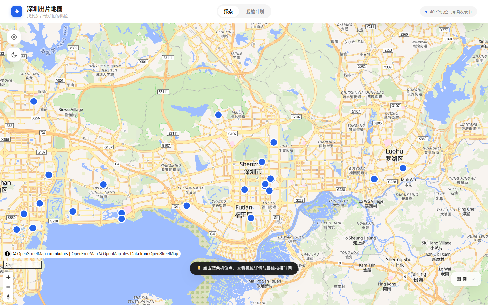
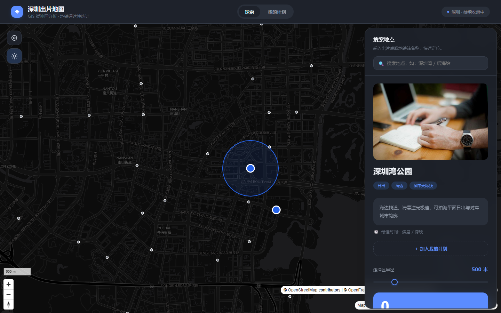
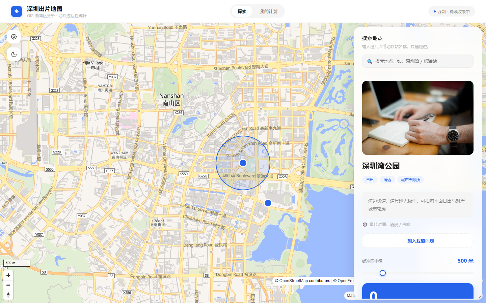

# 深圳拍摄点地图

这是一个为摄影师/模特提供服务的一个企划，目前项目还在实验与打磨中，数据准确性待核实。在线链接：https://bujianshu315.github.io/shenzhen-photo-map/

## 为什么做

摄影爱好者找一个好机位，往往要在社交媒体、地图之间来回切换：机位散在帖子里，交通方不方便要另查，拍之前还得自己串路线。

这个项目想把这些收进一张地图里：

- **机位直观**：出片点直接标在地图上，带示例图、标签、最佳拍摄时间；
- **通达性参考**：点击出片点自动做 GIS 缓冲区分析，统计半径内地铁站数量，一目了然；
- **路线参考**：收藏进"我的计划"后自动按最近邻串成拍摄路线，导航交给其他地图工具

## 功能亮点

- 地图展示：全屏布局，OpenFreeMap 矢量底图
- 机位标注：机位醒目、地铁站隐藏，缓冲区内可见
- 缓冲区分析：点击机位自动绘制缓冲区（turf.js），统计范围内地铁站数量，滑块实时调整半径
- 详情面板：示例图、标签、点评、出发、最佳拍摄时间
- 搜索：按区域，名称搜索摄影机位
- 用户定位：LBS 获取当前位置并标注，作为路线规划起点
- 我的计划：收藏 / 移除 / 清空出片点，localStorage 本地持久化
- 计划分享：一键导出 JSON 计划文件发给朋友，对方导入即可复刻同款拍摄路线（借鉴 MiriaGo 数据包思路）
- 计划网络：贪心最近邻算法把计划点串成路线，可以给出一个机位之间空间关系的参考
- 路线规划：URI 深链跳转所选导航软件（高德 / 百度 / 腾讯 / Google / OSM 五选一，浏览器记忆偏好）
- 朝向示意：已补录朝向数据的机位会显示拍摄方向扇形（数据持续补充中）
- 主题切换：深色 / 浅色双主题（深色参考高德配色），刷新后保持，切换带圆形揭幕动画
- 移动端适配：面板在小屏上变为底部抽屉

## 效果展示

| 浅色模式                                | 深色模式                               | 缓冲区分析                                 |
| ----------------------------------- | ---------------------------------- | ------------------------------------- |
|  |  |  |

## 快速使用

本项目是纯静态页面，但要通过 HTTP 服务访问——直接双击 `index.html` 走 `file://` 协议会被浏览器 CORS 拦截，结果是底图能显示、点位和地铁站读不出来（页面会弹出黄色提示条）。

**Windows 用户：直接双击 `启动地图.bat`。** 它会自动起好本地服务并打开浏览器，用完关闭那个黑色窗口即可停止服务，无需安装 Python 或 Node。

**其他系统 / 手动方式**（任选其一，需已安装 Python 或 Node）：

```bash
python -m http.server 8000
npx serve .
```

如果使用 Node，可用项目脚本复现运行和检查：

```bash
npm install
npm start
npm run check
```

计划页导航默认把项目内部的 WGS-84 坐标转换为高德所需的 GCJ-02；Google Maps 和 OpenStreetMap 保持 WGS-84。点位数据不要提前写死成高德坐标，避免重复偏移。

然后浏览器打开 `http://localhost:8000`。

部署：直接把本目录推到 GitHub 仓库，开启 GitHub Pages 即可（纯静态，零构建）。GitHub Pages 使用 HTTPS 提供 JSON 和图片文件，其他人打开网页不需要 Workbuddy；只有直接双击 `index.html` 时才会受到 `file://` 安全限制。

## 怎么加一个出片点

打开 `spots.json`，照着已有格式加一条：

```json
{
  "name": "点位的名字",
  "lng": 114.0000,
  "lat": 22.5000,
  "tags": ["夜景", "海边"],
  "note": "一句点评",
  "best_time": "夜晚",
  "image": "示例图 URL，或留空"
}
```

坐标（WGS-84）可从高德 / 百度「坐标拾取器」或 OSM 右键获取。

## 数据来源与第三方署名

本项目代码使用 MIT License 开源，但项目中展示或访问的第三方数据不属于本项目：

- **地铁站数据**（`metro.json`）：来自 [OpenStreetMap](https://www.openstreetmap.org/)（通过 Overpass API 查询，含线路号），© OpenStreetMap contributors，遵循 [ODbL 协议](https://opendatacommons.org/licenses/odbl/)。
- **地图底图**：来自 [OpenFreeMap](https://openfreemap.org/)（基于 OpenStreetMap 数据），使用时应保留相应署名。开源数据的行政边界画法（如全国尺度细节）不代表作者立场；本项目为个人实验作品，非商业地图服务。
- **出片点数据**（`spots.json`）：作者自维护。详情图优先加载仓库内 `assets/photos/webp/` 的 WebP 缩略图，外链图片作为备用来源。使用 Wikimedia Commons 图片的点位应保留作者和许可证来源链接；部分图片仅作场景参考，并非对应机位的实拍。
- 导航能力由其他地图提供，路线计算不在本项目内进行。

## 技术栈（全部免费）

- 地图：MapLibre GL JS + OpenFreeMap
- GIS 分析：turf.js（缓冲区 + 点面统计）
- 数据：JSON 文件（无需后端数据库）
- 托管：GitHub Pages / Vercel 均可

## 待定

- [x] 点位扩充：已扩充至 40 个深圳实地机位（配图暂为 Wikimedia Commons 场景示意图，正逐步替换为实地拍摄作品）

- [ ] 接入AI：开放API接口，让机位筛选，拍摄注意事项等更智能化

- [x] 计划分享：导出 / 导入拍摄计划（JSON 文件）

- [ ] 移动端/桌面端：微信小程序跑不了 MapLibre、桌面端和移动端有待考量

本项目代码基于 [MIT License](LICENSE) 开源。如有问题欢迎提Issues
